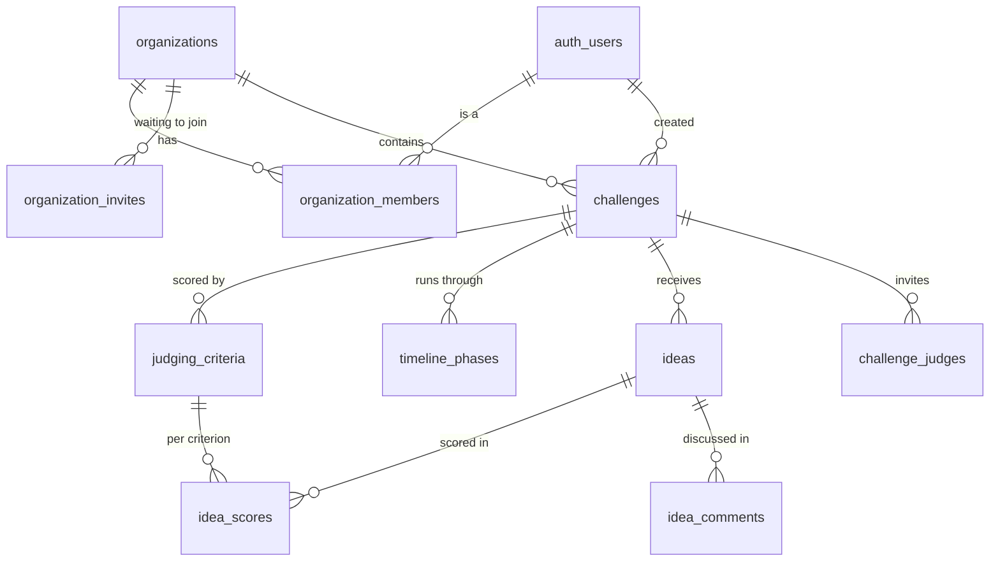

# Database schema

Source of truth: `supabase/migrations/*.sql`. Every table has Row Level Security turned on.

## 1. Current tables

| Table | Purpose | Who can access |
|---|---|---|
| `organizations` | A workspace (name) | Members read; admins rename |
| `organization_members` | One row per person per role (admin, organiser, judge, mentor, participant, project_owner), with their email | Members read; changed only via `accept_org_invites()` and `remove_org_member()` |
| `organization_invites` | Waiting invitations (email + role) | Admins only |
| `challenges` | One innovation challenge in a workspace (`organization_id`); `owner_id` records who created it | Admins and organisers of the workspace; public reads via `get_public_challenge()` for published ones |
| `judging_criteria` | Weighted criteria (weights total 100) | Admins and organisers |
| `timeline_phases` | Dated phases | Admins and organisers |
| `ideas` | Submissions (name, email, title, description, private `thread_token`) | Admins and organisers read/delete; visitors insert only via `submit_idea()` |
| `challenge_judges` | Judges invited to one challenge by email | Admins and organisers |
| `idea_scores` | One score 0–10 per idea × criterion × judge | Only through `get_judging()` / `save_scores()` |
| `idea_comments` | Discussion messages with up to 3 attachments | Only through `get_discussion()` / `post_comment()` |

Key functions: `has_org_role`, `is_org_member`, `can_manage_challenge`, `ensure_workspace`,
`accept_org_invites`, `remove_org_member`, `get_public_challenge`, `submit_idea`, `judging_role`, `get_judging`, `save_scores`,
`my_judging_challenges`, `idea_totals`, `discussion_viewer`, `get_discussion`, `post_comment`,
`delete_comment`, `upload_path_ok`. Storage bucket: `idea-files`.

## 2. Proposed additions (not applied yet)

These reuse and extend the tables above; nothing is renamed or removed.

| Phase | New or changed | Notes |
|---|---|---|
| 3 | ✅ `organizations`, `organization_members`, `organization_invites`; `challenges.organization_id` | Applied 27 Nov 2026 |
| 3 | `platform_admins` | For the platform super-admin role |
| 3 | `notifications`, `activity_logs` | In-app only |
| 4 | `innovation_programs`; `challenges.program_id`, `format`, `event_*` fields, wider `status` | Hackathon = challenge with a format |
| 4 | `registrations`, `participant_profiles`, `teams`, `team_members`, `mentor_assignments`, `mentoring_sessions` | |
| 5 | `ideas` gains `team_id`, `solution`, `category`, `links`, `status`, `updated_at`; `idea_files` | Submissions stay in `ideas` |
| 5 | `judge_assignments`, `conflict_declarations`, `ai_evaluations`, `awards` | AI scores kept separate from human scores |
| 6 | `pipeline_stages`, `innovation_projects`, `project_members`, `milestones`, `tasks`, `experiments`, `impact_metrics` | Impact has `estimated` and `verified` values |
| 7 | `ai_usage_logs` | Per-organisation daily limits |
| 9 | `plans`, `subscriptions` | Prices configurable, nothing hard-coded |
