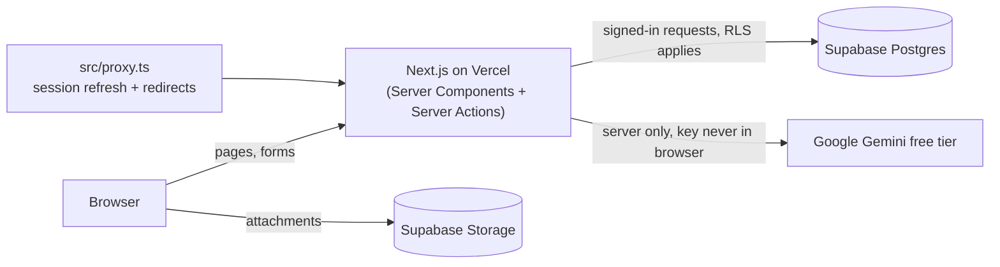

# Technical architecture

## 1. How it fits together today



- **Pages** read data in Server Components behind `<Suspense>` (required by Cache Components when a
  page reads the login cookie).
- **Changes** go through Server Actions, which re-check the user and validate input with Zod.
- **Security** lives in Postgres: Row Level Security on every table, and `security definer` functions
  (for example `submit_idea`, `get_judging`, `save_scores`) for the few things visitors or judges may do,
  each with its own explicit checks.
- **AI** runs only on the server. `src/lib/ai/gemini.ts` asks for JSON matching a schema; feature code
  (for example `src/lib/plan/ai-draft.ts`) then validates and corrects the answer before a person
  reviews it.

## 2. Folder map

| Folder | Holds |
|---|---|
| `src/app` | Pages and Server Actions, one folder per route |
| `src/components` | Shared UI (header, discussion board, dropdown, illustrations) |
| `src/lib/<area>` | Rules and helpers per area (plan, judging, ideas, discussion, ai, roadmap), each with tests |
| `supabase/migrations` | Database changes, in date order |
| `supabase/tests` | SQL security checks |
| `docs` | These documents |

## 3. Proposed: organisations and roles (Phase 3, needs approval)

**Why:** every later feature belongs to an organisation and depends on who the person is there.

**What changes (additive only):**

1. New `organizations` and `organization_members (organization_id, user_id, role)` tables.
   Roles: `admin`, `organiser`, `judge`, `mentor`, `participant`, `project_owner`. A person can hold
   several roles. Platform super admins sit in a separate `platform_admins` table.
2. New nullable `organization_id` on `challenges`.
3. Backfill: for each existing challenge owner, create one workspace named after them, make them
   `admin`, and set `organization_id` on their challenges. Then make the column required.
4. Security rules for challenges change from "owner only" to "members of the challenge's
   organisation, by role" (admins and organisers manage; judges and mentors read what they are
   assigned). The existing owner keeps full access, so nothing changes for current users.
5. Existing judge invitations by email keep working unchanged.

**Rollback:** the old `owner_id` column stays, so the previous rules can be restored by one migration.

## 4. Proposed: AI layer (Phase 7, started)

```
src/lib/ai/
  gemini.ts        provider client (done)
  provider.ts      common interface: generateJson(request) → result      (planned)
  usage.ts         log each call to ai_usage_logs, enforce per-organisation daily limits (planned)
features call:  ai.generateJson({ feature: "plan-draft", ... })
```

Rules: keys server-side only; structured output; validate before saving; human approval; loading,
error and retry states; record every evaluation (`ai_evaluations`).

## 5. Free-tier limits to design around

| Service | Free limit that matters |
|---|---|
| Supabase | 500 MB database, 1 GB files, project pauses after a week of no activity |
| Vercel Hobby | Non-commercial use only |
| Gemini free tier | Per-minute and per-day request caps; prompts may be used to improve Google's products |
| Supabase built-in email | Very low hourly limit; fine for sign-up confirmation, not for notifications |
